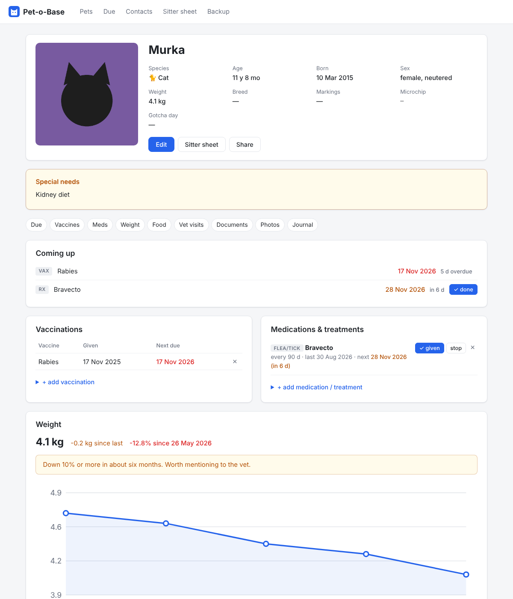

# Cat-o-Base

A small self-hosted web app for keeping your cats' records in one place:
vaccinations, medications, weight, vet visits, documents, photos, food and
special needs.

Flask + SQLite, no Docker needed. It's built to run in a tiny Proxmox LXC
(512 MB RAM, 4 GB disk), but works on any Debian or Ubuntu machine.


## Features

- **Cat cards** with photo, age, sex and current weight. A card gets a red or
  amber outline when something is overdue or due soon.
- **Vaccinations** with "repeats every year / every 3 years". The next due date
  is worked out for you.
- **Medications and treatments** (medication, flea/tick, deworming,
  supplements) with dose, schedule, repeat interval and end date. Click
  **✓ given** and the next due date moves forward.
- **"Due" dashboard** listing everything overdue or coming up, across all cats.
- **Weight history** with a chart. It warns you if a cat has lost 10% or more
  in about six months.
- **Vet visits log**: date, clinic, reason, outcome, cost.
- **Documents**: upload lab results, vaccination certificates, insurance papers.
- **Photo gallery** per cat. Upload several at once and pick a profile photo.
  iPhone HEIC photos are supported.
- **Food** details: brand, portion, schedule, special food needs, refusals.
- **Special needs and allergies**, shown prominently on the cat's page.
- **Journal** for grooming, nails, litter, behaviour, symptoms, food trials.
- **Contacts**: vet, emergency vet, insurance, backup sitter.
- **Sitter sheet**: one printable page with food, meds, quirks and contacts.
- **Calendar feed** (`/calendar.ics`): due dates with a 9:00 reminder,
  birthdays and adoption days.
- **Backup and restore**: one-click zip of the database and all files.
- **Archive** a cat to hide it from the main list while keeping the records.
- **Works on phones**, and follows your system's light or dark mode.



## Quick start

On a fresh Debian 12/13 container or VM, as root:

```bash
git clone https://github.com/dhomak/cat-o-base.git
cd cat-o-base
./install.sh
```

Then open `http://<container-ip>:8000`.

**[INSTALL.md](INSTALL.md)** walks through the whole thing step by step:
creating the LXC in the Proxmox web UI, getting the files in, reverse proxy,
updates, backups and troubleshooting.

## Security note

Cat-o-Base has **no login**. It's meant for your home network or tailnet. If
you expose it to the internet, put it behind a reverse proxy with
authentication (for example an Nginx Proxy Manager access list, Authelia or
Cloudflare Access).

## Configuration

Set these as environment variables in the systemd unit
(`/etc/systemd/system/cat-o-base.service`):

| Variable | Default | Meaning |
|---|---|---|
| `CATOBASE_DATA` | `/var/lib/cat-o-base` | Database, photos and documents |
| `CATOBASE_MAX_UPLOAD_MB` | `200` | Largest upload allowed per request |
| `CATOBASE_PORT` | `8000` | Port (read by `install.sh` only) |

## Development

```bash
python3 -m venv .venv && . .venv/bin/activate
pip install -r requirements.txt
python app.py          # http://localhost:8000, data goes into ./data
```

## iPhone, iPad and Mac app

A native SwiftUI version is in progress in [`apple/`](apple/). It stores data
on the device, with iCloud sync planned. See [apple/README.md](apple/README.md).

## Project layout

```
apple/              native SwiftUI app (iPhone, iPad, Mac)
app.py              the whole backend (routes, DB schema, calendar, backup)
templates/          Jinja templates
static/             CSS, JS, icon
install.sh          installer and updater for Debian/Ubuntu
INSTALL.md          step-by-step install guide
```

## License

[MIT](LICENSE) © 2026 David Khomak
