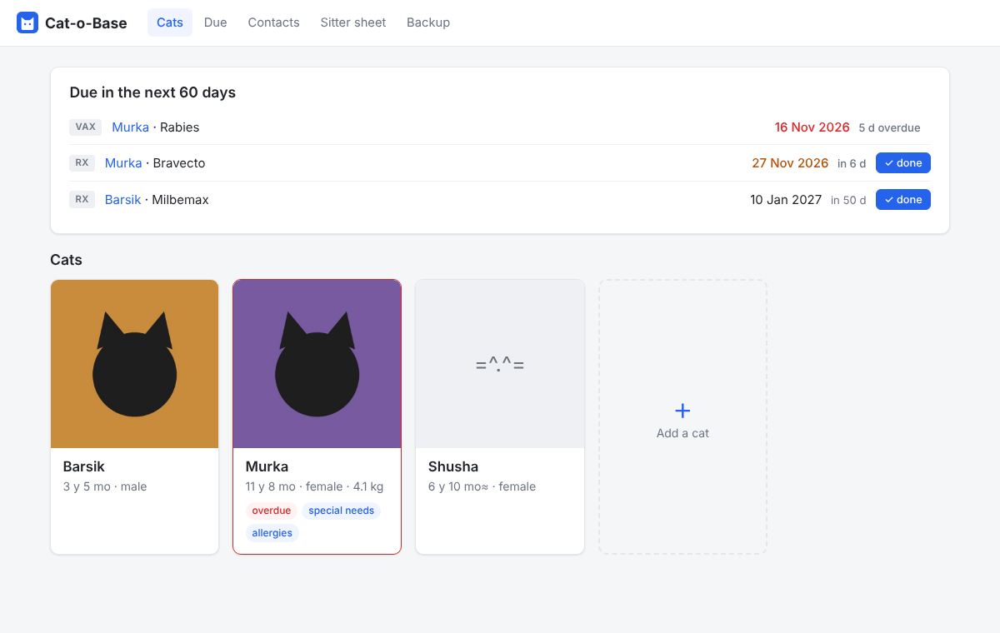

# Pet-o-Base

A small self-hosted web app for keeping your cats' records in one place:
vaccinations, medications, weight, vet visits, documents, photos, food and
special needs.

Flask + SQLite, no Docker needed. It's built to run in a tiny Proxmox LXC
(512 MB RAM, 4 GB disk), but works on any Debian or Ubuntu machine.



## Features

- **Any kind of pet:** cat, dog, rabbit, bird, rat or other, each with its
  own icon, breed hint and vaccine suggestions.
- **Guest pets** you look after for someone: owner's name, since when, and
  their contacts, listed separately under Guest Pets.
- **Sharing:** a readable summary to copy or send from your phone, and a
  `.petobase` file that opens in Pet-o-Base on iPhone and Mac. Shared pets
  from the iPhone app import here as guest pets (Backup page).
- **Contacts** with call, SMS, WhatsApp and Telegram links. Numbers starting
  with 0 get the country code from `CATOBASE_COUNTRY_CODE` (default 972).
- **Sort** by name or age, and **search**.

- **Cat cards** with photo, age, sex and current weight. A card gets a red or
  amber outline when something is overdue or due soon.
- **Vaccinations** with "repeats every year / every 3 years". The next due date
  is worked out for you.
- **Medications and treatments** (medication, flea/tick, deworming,
  supplements) with dose, schedule, repeat interval and end date. Click
  **✓ given** and the next due date moves forward.
- **"Due" dashboard** listing everything overdue or coming up, across all cats.
- **Weight history** with a chart. It warns you if a cat has lost 10% or more
  in about six months.
- **Vet visits log**: date, clinic, reason, outcome, cost.
- **Documents**: upload lab results, vaccination certificates, insurance papers.
- **Photo gallery** per cat. Upload several at once and pick a profile photo.
  iPhone HEIC photos are supported.
- **Food** details: brand, portion, schedule, special food needs, refusals.
- **Special needs and allergies**, shown prominently on the cat's page.
- **Journal** for grooming, nails, litter, behaviour, symptoms, food trials.
- **Contacts**: vet, emergency vet, insurance, backup sitter.
- **Sitter sheet**: one printable page with food, meds, quirks and contacts.
- **Calendar feed** (`/calendar.ics`): due dates with a 9:00 reminder,
  birthdays and adoption days.
- **Backup and restore**: one-click zip of the database and all files.
- **Archive** a cat to hide it from the main list while keeping the records.
- **Works on phones**, and follows your system's light or dark mode.


## Quick start

On a fresh Debian 12/13 container or VM, as root:

```bash
git clone https://github.com/dhomak/pet-o-base.git
cd pet-o-base
./install.sh
```

Then open `http://<container-ip>:8000`.

**[INSTALL.md](INSTALL.md)** walks through the whole thing step by step:
creating the LXC in the Proxmox web UI, getting the files in, reverse proxy,
updates, backups and troubleshooting.

## Security note

Pet-o-Base has **no login**. It's meant for your home network or tailnet. If
you expose it to the internet, put it behind a reverse proxy with
authentication (for example an Nginx Proxy Manager access list, Authelia or
Cloudflare Access).

## HTTPS with a reverse proxy

The app speaks plain HTTP on port 8000. Put it behind a reverse proxy to get
`https://` and a proper name. That also makes the browser's **Share** button work,
because browsers only allow it on secure pages. The app reads the proxy's
`X-Forwarded-Proto` and `X-Forwarded-Host` headers, so links such as the calendar
feed come out as `https://pets.example.com/…`.

With Nginx Proxy Manager:

1. **Hosts → Proxy Hosts → Add Proxy Host.**
   - Domain name: `pets.example.com`
   - Scheme `http`, forward hostname: the container's IP, port `8000`
   - Tick **Block Common Exploits**.
2. **SSL tab:** pick your existing certificate (a wildcard `*.example.com` works for
   every service), or request a new Let's Encrypt one. If the name is only reachable
   at home, use **DNS Challenge** with your DNS provider (e.g. a Cloudflare API token),
   because Let's Encrypt can't reach the server to check it.
   Tick **Force SSL** and **HTTP/2 Support**.
3. **DNS:** point the name at the proxy. On a home network with AdGuard Home or
   Pi-hole, a DNS rewrite to the proxy's IP is enough.

Uploads: NPM allows large uploads by default. If photo uploads or a restore fail
with "413 Request Entity Too Large", add `client_max_body_size 200m;` in the proxy
host's **Advanced** tab. Behind Cloudflare's proxy (orange cloud), uploads are
capped at 100 MB per request on the free plan.

## Languages

The web app is available in English, Russian and Ukrainian. It follows the browser's language, and the EN / RU / UK switch in the top-right corner overrides it (remembered in a cookie).

Translations live in `translations.py`, one row per string: English, Russian, Ukrainian. To fix a wording, edit the row and restart the service (`systemctl restart cat-o-base`), or just rerun the installer after `git pull`. A string missing from the table is shown in English.

## Configuration

Set these as environment variables in the systemd unit
(`/etc/systemd/system/cat-o-base.service`):

| Variable | Default | Meaning |
|---|---|---|
| `CATOBASE_DATA` | `/var/lib/cat-o-base` | Database, photos and documents |
| `CATOBASE_MAX_UPLOAD_MB` | `200` | Largest upload allowed per request |
| `CATOBASE_PORT` | `8000` | Port (read by `install.sh` only) |

## Development

```bash
python3 -m venv .venv && . .venv/bin/activate
pip install -r requirements.txt
python app.py          # http://localhost:8000, data goes into ./data
```

## iPhone, iPad and Mac app

A native SwiftUI version is in progress in [`apple/`](apple/). It stores data
on the device, with iCloud sync planned. See [apple/README.md](apple/README.md).

## Project layout

```
apple/              native SwiftUI app (iPhone, iPad, Mac)
app.py              the whole backend (routes, DB schema, calendar, backup)
i18n.py             language detection, dates and plurals
translations.py     Russian and Ukrainian strings
templates/          Jinja templates
static/             CSS, JS, icon
install.sh          installer and updater for Debian/Ubuntu
INSTALL.md          step-by-step install guide
```

## License

[MIT](LICENSE) © 2026 David Khomak
