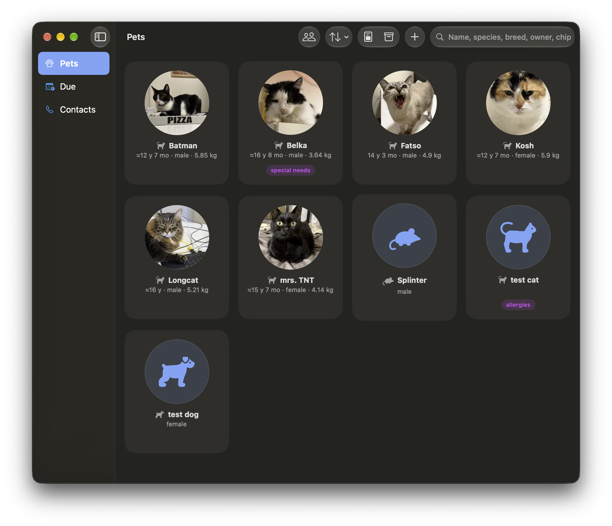

# Pet-o-Base for iPhone, iPad and Mac

A native SwiftUI app. One app target runs on iOS, iPadOS and macOS 27.
Data is stored on the device with SwiftData; the model is ready for iCloud
sync later.



**Status:** phases 1–7 done; phase 8 (iCloud sync) waits on the developer
account. Pets of any species (cat, dog, rabbit, bird, rat, other) with
round profile photos, a crop editor and automatic centring for cats and dogs;
vaccinations, medications and treatments with a Due tab and reminders;
weight tracking with a chart; vet visits, documents (with a scanner), photo
galleries and a journal; contacts with call/WhatsApp/Telegram; guest pets you
look after; sharing a pet (choosing what to include) through Messages,
Telegram and the rest; sitter sheet PDF; backup and import, including from
the web app. Mac and iPad: menu bar, shortcuts, drag and drop, multiple
windows, Continuity Camera. See [the roadmap](#roadmap).

## First-time setup

You need a Mac with Xcode 27 and [Homebrew](https://brew.sh).

### 1. Get the code and install XcodeGen

The Xcode project file isn't stored in git. It's generated from
`project.yml` by XcodeGen, which avoids merge conflicts in the project file.

```bash
git clone https://github.com/dhomak/pet-o-base.git
cd pet-o-base/apple
brew install xcodegen
```

### 2. Tell it your signing team

Find your team ID. This command prints it from the development certificate
Xcode already created for you:

```bash
security find-certificate -c "Apple Development" -p | openssl x509 -noout -subject | grep -o 'OU=[A-Z0-9]*' | cut -d= -f2
```

It's a 10-character code like `AB12CD34EF`. Save it in a file that git
ignores:

```bash
echo 'DEVELOPMENT_TEAM = AB12CD34EF' > Config/Local.xcconfig
```

Use your own code, not the example. If the command prints nothing, build any
project to your phone once (like the Hello World test) so Xcode creates the
certificate, then try again.

### 3. Generate and open the project

```bash
xcodegen
open CatOBase.xcodeproj
```

### 4. Run it

Pick your iPhone (or **My Mac**, or an iPad simulator) in the device menu at
the top of Xcode and press **⌘R**.

## After pulling new code

```bash
cd pet-o-base/apple
git pull
xcodegen          # picks up new or renamed files
```

Then press ⌘R in Xcode. If Xcode was open, it reloads the project
automatically.

## Sharing a pet

On a pet's page, tap **Share**. Choose what to include, then send it with the
standard share sheet. The recipient gets a readable summary plus a
`Name.petobase` file; opening that file in Pet-o-Base (from Messages,
Telegram, Mail, Files or Finder) adds the pet under **Guest Pets**. Sharing
the same pet again lets them update their copy. Shares are snapshots: there's
no live sync, which would need iCloud.

## Languages

The app is in English, Russian and Ukrainian, and follows the device language.
To run just Pet-o-Base in another language:

- **iPhone and iPad:** Settings → Apps → Pet-o-Base → Language.
- **Mac:** System Settings → General → Language & Region → Applications → +.

In Xcode you can preview a language without changing the device: Product →
Scheme → Edit Scheme → Run → Options → App Language.

All the text lives in `CatOBase/Localizable.xcstrings`; open it in Xcode to
edit translations. Permission prompts are in `CatOBase/InfoPlist.xcstrings`.
When the code gets new text, Xcode adds it to the catalog on the next build,
marked as needing translation; until then it shows in English.

## Keyboard shortcuts (Mac, and iPad with a keyboard)

| | |
|---|---|
| ⌘N / ⇧⌘N | New cat / new guest cat |
| ⌥⌘N | New window |
| ⌘E | Edit the cat |
| ⌥⌘L | Log weight |
| ⌥⌘V / ⌥⌘M | Add vaccination / medication |
| ⇧⌘S | Share the cat |
| ⌘P | Sitter sheet |
| ⇧⌘O | Open the cat in a new window |
| ← → | Previous / next photo in the viewer |
| ⌘, | Settings (Mac) |

Drag photos or PDFs onto a pet's page to add them. On the Mac, **File → Import
from iPhone** takes a photo or scans a document with your phone.

## App icon

See [ICON.md](ICON.md): make a 1024 × 1024 PNG and run `tools/make-icons.sh`.

## Free Apple account notes

- The app runs for **7 days**, then needs re-installing from Xcode (⌘R).
  Your data is kept.
- If you get "maximum number of apps", delete the old Hello World test app
  from the phone.
- iCloud sync needs the paid Developer Program. The app is built so that
  switching it on later is a small change (see `CatOBaseApp.swift`).

## Project layout

```
project.yml                 XcodeGen project definition (iOS + macOS, version 27)
Config/Base.xcconfig        shared settings; includes your Local.xcconfig
CatOBase/
  CatOBaseApp.swift         app entry, database setup
  Models/Models.swift       SwiftData models (CloudKit-compatible)
  Views/                    screens
  Support/                  image handling, formatting, preview sample data
  Assets.xcassets           app icon, accent colour
  Localizable.xcstrings     English, Russian and Ukrainian text
  InfoPlist.xcstrings       translated permission prompts
```

## Roadmap

1. **Skeleton** ✅: models, cat grid, cat page, add/edit/archive/delete, contacts
2. **Health** ✅: vaccinations, treatments with "✓ given", the Due tab
3. **Weight** ✅: logging in kg or lb, Swift Charts graph, weight-loss warning
4. **Media** ✅: photo gallery, documents with QuickLook, round-avatar crop
   editor with automatic cat detection
5. **Reminders** ✅: local notifications for due dates, app icon badge
6. **Sharing and backup** ✅: sitter sheet PDF, export/import, import from the
   Pet-o-Base web app
7. **iPad and Mac polish** ✅: menus, shortcuts, drag and drop, multiple windows,
   Continuity Camera, search
8. **Later:** iCloud sync, widget, Siri/Shortcuts
